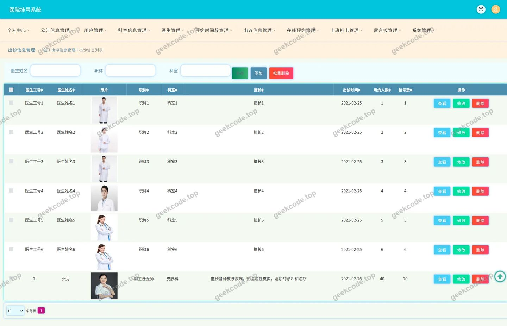
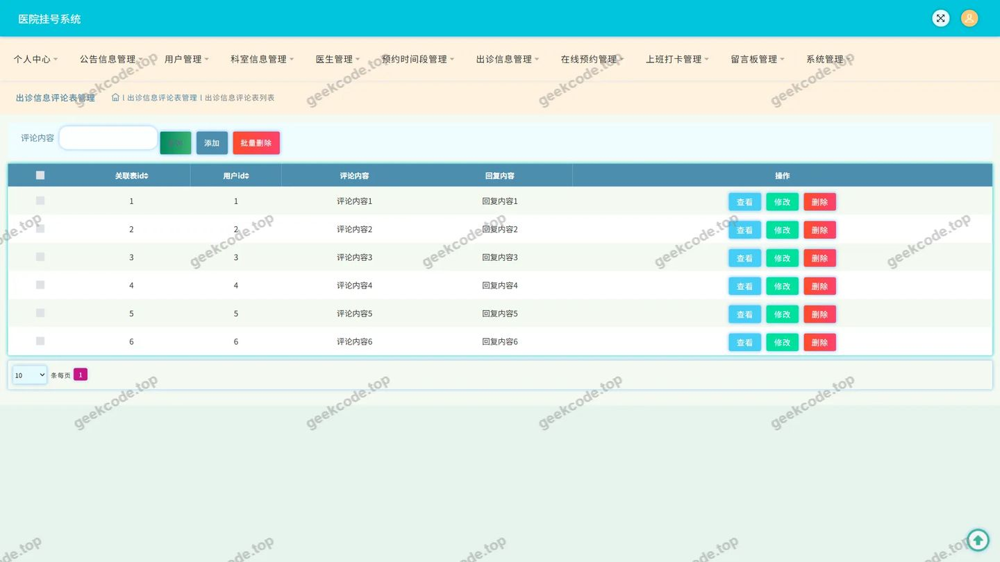
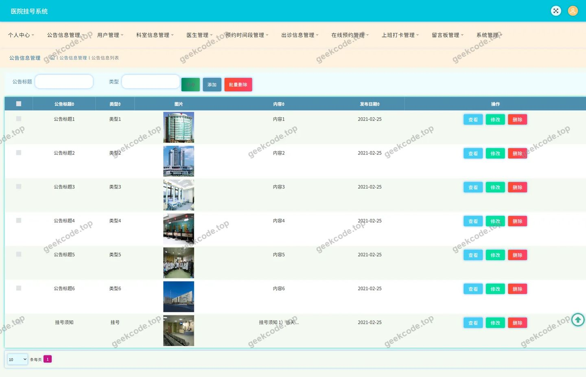
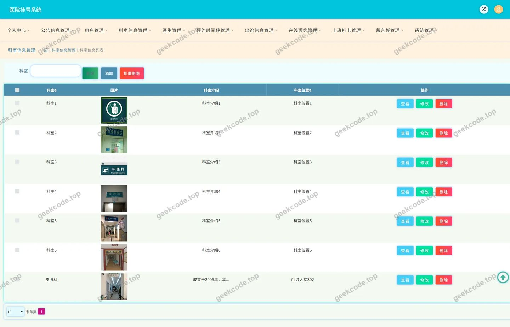
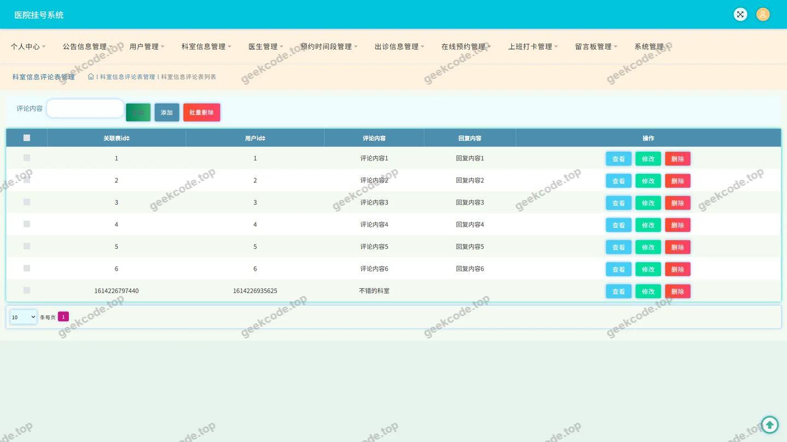
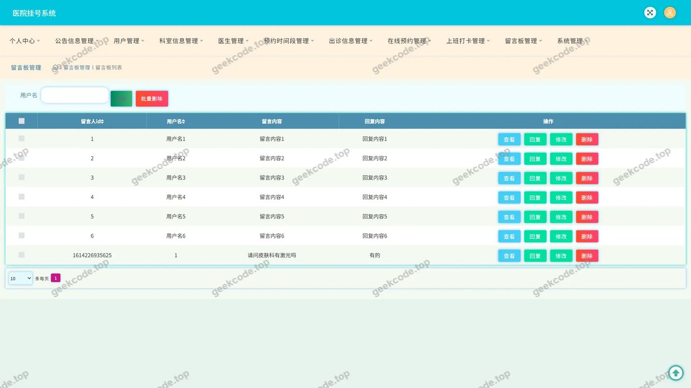
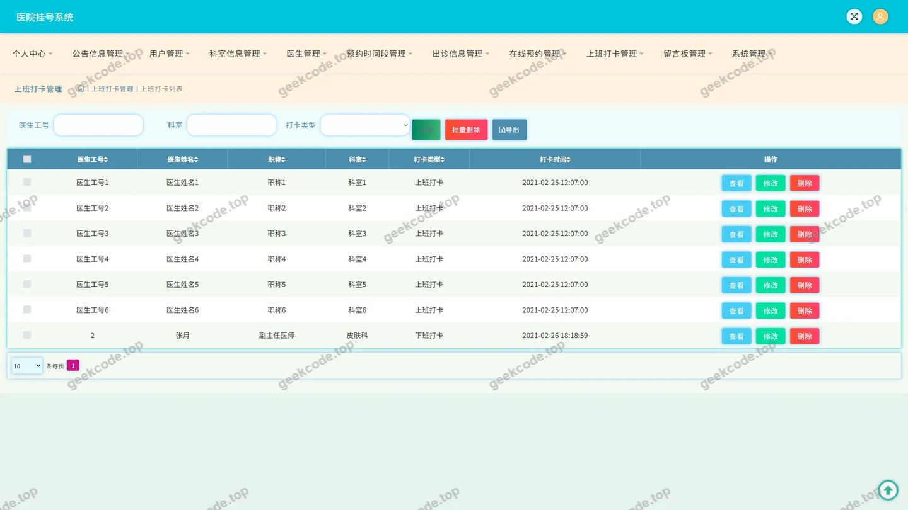

# 医院打卡挂号系统

> 🎓 **计算机毕业设计 · 医院打卡挂号系统**
>
> 本仓库只放**项目介绍 + 运行截图**（截图是站点带水印的原图，存在仓库 `images/` 里）。
>
> 👉 **完整可运行源码 / 数据库脚本 / 部署文档：[点我获取](https://geekcode.top/archives/%E5%8C%BB%E9%99%A2%E6%89%93%E5%8D%A1%E6%8C%82%E5%8F%B7%E7%B3%BB%E7%BB%9F?utm_source=github)**
>
> 💬 咨询微信：**ir9372**　|　🌐 更多项目：[极客代码 geekcode.top](https://geekcode.top/?utm_source=github)
>
> 📌 项目详情页：<https://geekcode.top/archives/%E5%8C%BB%E9%99%A2%E6%89%93%E5%8D%A1%E6%8C%82%E5%8F%B7%E7%B3%BB%E7%BB%9F?utm_source=github>

<table><td width="230" align="center"> <b>扫码加微信 ir9372</b></td><td valign="middle">📦 源码 = 项目介绍 + 全部运行截图 + 数据库 + 部署文档 👉 点上方任意截图，直接跳到 <b>极客代码 geekcode.top</b> 详情页</td></table>

---

<h1>医院打卡挂号系统</h1>
<h2>项目概述</h2>

本项目名为“医院打卡挂号系统”，旨在为医疗机构提供一套基于后端服务的数据管理与业务处理解决方案。系统核心功能涵盖公告信息展示、科室信息管理、出诊信息查询以及留言反馈机制，同时支持用户进行上班打卡与内容收藏操作。适用人群主要为医院内部工作人员及需要获取医院动态信息的注册用户。技术架构上，项目采用纯 API 模式开发，未包含独立的前台页面渲染或后台管理界面，专注于数据交互与服务逻辑实现，通过 RESTful 接口对外提供服务，确保数据处理的规范性与安全性。

<h2>技术架构</h2>

本项目基于 Java 语言开发，采用 Spring Framework 生态体系构建后端服务。核心依赖包括 spring-core, spring-context, spring-web, spring-webmvc 等模块，实现了控制层（Controller）与业务逻辑层的解耦。持久层选用 MyBatis-Plus 框架，简化了数据库操作代码，并结合 Druid 连接池优化数据库连接性能，保障高并发下的稳定性。事务管理依托 spring-tx 组件，确保数据一致性。AOP 切面编程通过 spring-aop 实现，用于处理日志记录或权限校验等横切关注点。由于项目定位为 pure-api 类型，前后端分离彻底，前端仅作为 API 调用方，后端负责所有业务逻辑处理与数据返回，数据库设计需严格遵循第三范式以支持多表关联查询（如评论与主帖关联）。

<h2>功能模块</h2>

根据源码中的 Controller 列表及截图功能，系统主要包含以下功能模块：

<ol>
<li><strong>基础信息管理模块</strong></li>
</ol>
<ul>
<li><strong>公告信息管理</strong>：提供医院公告的发布、查询与维护功能（对应 <code>GonggaoxinxiController</code>）。</li>
<li><strong>科室信息管理</strong>：维护医院各科室的基本资料与状态（对应 <code>KeshixinxiController</code>）。</li>
<li><strong>出诊信息管理</strong>：记录医生出诊时间、地点及状态等信息（对应 <code>ChuzhenxinxiController</code>）。</li>
</ul>
<ol start="2">
<li><strong>互动与反馈模块</strong></li>
</ol>
<ul>
<li><strong>留言反馈系统</strong>：支持用户对公告、科室、出诊信息进行评论与反馈（对应 <code>DiscusschuzhenxinxiController</code>, <code>DiscussgonggaoxinxiController</code>, <code>DiscusskeshixinxiController</code>）。</li>
<li><strong>站内消息</strong>：处理系统内的通知或用户间消息传递（对应 <code>MessagesController</code>）。</li>
</ul>
<ol start="3">
<li><strong>用户业务模块</strong></li>
</ol>
<ul>
<li><strong>上班打卡</strong>：处理用户的考勤打卡请求，记录打卡时间与状态（对应 <code>ShangbandakaController</code>）。</li>
<li><strong>收藏功能</strong>：支持用户对感兴趣的信息内容进行收藏与管理（对应 <code>StoreupController</code>）。</li>
<li><strong>个人中心</strong>：提供用户基本信息的查看与维护入口（对应 <code>CommonController</code> 及相关配置）。</li>
</ul>
<ol start="4">
<li><strong>系统支撑模块</strong></li>
</ol>
<ul>
<li><strong>文件服务</strong>：处理图片、文档等文件的上传与存储请求（对应 <code>FileController</code>）。</li>
<li><strong>配置管理</strong>：管理系统全局参数与运行配置（对应 <code>ConfigController</code>）。</li>
</ul>
<h2>用户角色与权限</h2>

由于项目类型为 pure-api 且无显式的前台/后台路由定义，权限控制主要通过 API 接口的访问策略实现。根据现有代码上下文，无法确定具体的角色划分（如管理员与普通用户的具体枚举），但依据功能模块可推断出以下访问场景：

<ul>
<li>
<strong>普通用户（注册/登录态）</strong>：

</li>
<li>
可访问：公告信息、科室信息、出诊信息的读取接口。

</li>
<li>
可操作：发表对公告、科室、出诊信息的评论；执行上班打卡操作；收藏/取消收藏信息；查看个人收藏列表；发送留言反馈。

</li>
<li>
受限：无法直接修改基础数据（如新增科室或公告），除非拥有特定 Token 或角色标识。

</li>
<li>
<strong>系统管理员（隐含角色）</strong>：

</li>
<li>
虽然无后台 UI，但通过 <code>ConfigController</code> 和基础数据的增删改查接口，具备对公告、科室、出诊信息进行全量管理的权限。

</li>
<li>
可查看和管理所有用户的留言与反馈。

</li>
<li>
可管理系统配置文件及上传的文件资源。

</li>
</ul>

<em>注：具体权限校验逻辑依赖于 Spring Security 或自定义拦截器，源码中未明确展示角色注解，故以上权限基于通用 API 设计规范推导。</em>

<h2>项目特色与创新点</h2>
<ol>
<li><strong>轻量级 API 架构</strong>：摒弃传统 MVC 视图层耦合，采用 Pure-API 模式，使得系统更易于集成至移动端 App、小程序或第三方平台，具备良好的扩展性与跨端兼容性。</li>
<li><strong>业务闭环设计</strong>：将“信息展示”（公告/科室/出诊）与“用户行为”（打卡/收藏/评论）深度融合，不仅解决了信息不对称问题，还通过打卡功能强化了员工管理属性，通过评论功能增强了医患或同事间的互动性。</li>
<li><strong>高效数据交互</strong>：利用 MyBatis-Plus 的动态 SQL 能力与 Druid 连接池的高性能特性，在处理大量出诊信息与实时打卡数据时，能够保持较低的响应延迟，适合医院高频次访问的场景。</li>
</ol>
<h2>部署环境</h2>

为确保系统正常运行，建议部署以下软件环境：

<ul>
<li><strong>操作系统</strong>：Linux (CentOS 7+/Ubuntu 20.04+) 或 Windows Server 2016+。</li>
<li><strong>JDK 版本</strong>：Java Development Kit 8 或 11（需兼容 Spring Framework 5.x 及以上版本）。</li>
<li><strong>数据库</strong>：MySQL 5.7 或 MySQL 8.0，需启用 InnoDB 引擎以支持事务。</li>
<li><strong>构建工具</strong>：Maven 3.6+ 或 Gradle 6.0+。</li>
<li><strong>Web 服务器</strong>：内置 Tomcat（Spring Boot 默认）或外部 Nginx/Apache 作为反向代理。</li>
<li><strong>其他依赖</strong>：无需 Node.js 或微信开发者工具，因项目为纯后端 API 服务，不涉及前端编译打包过程。</li>
</ul>
<h2>五、技术特性</h2>
<ul>
<li>使用 MyBatis-Plus 简化数据访问层开发</li>
</ul>
<h2>六、功能模块截图</h2>
<h3>后台管理端</h3>
<h4>页面-出诊信息</h4>

<h4>页面-出诊信息评论</h4>

<h4>页面-登录</h4>

<h4>页面-公告信息</h4>

<h4>页面-公告信息评论</h4>

<h4>页面-科室信息</h4>

<h4>页面-科室信息评论</h4>

<h4>页面-留言板</h4>

<h4>页面-上班打卡</h4>

---

## 获取完整源码

| 项目 | 说明 |
| --- | --- |
| 项目名 | 医院打卡挂号系统 |
| 运行截图 | 本文 9 张（站点带水印原图，仓库 `images/` 目录） |
| 完整源码 | [https://geekcode.top/archives/%E5%8C%BB%E9%99%A2%E6%89%93%E5%8D%A1%E6%8C%82%E5%8F%B7%E7%B3%BB%E7%BB%9F?utm_source=github](https://geekcode.top/archives/%E5%8C%BB%E9%99%A2%E6%89%93%E5%8D%A1%E6%8C%82%E5%8F%B7%E7%B3%BB%E7%BB%9F?utm_source=github) |
| 咨询微信 | **ir9372**（备注：jingpin-yuanma） |
| 更多项目 | [极客代码 geekcode.top](https://geekcode.top/?utm_source=github) |

> 需要源码、部署、改配置、跑不起来等问题，加微信 ir9372 沟通，说明项目名即可。
